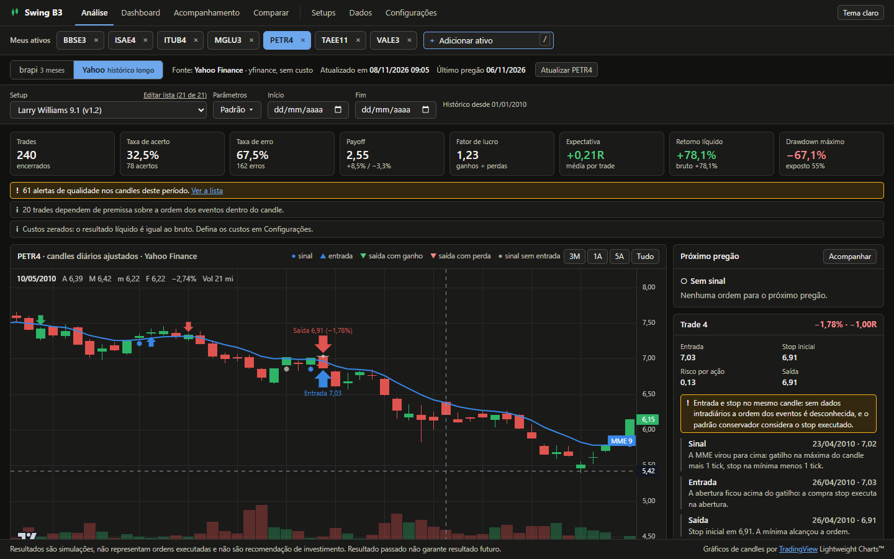
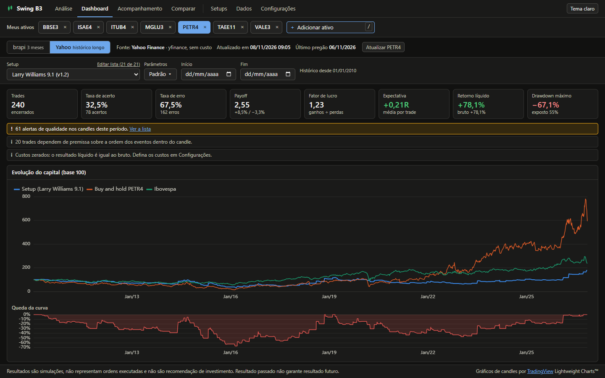
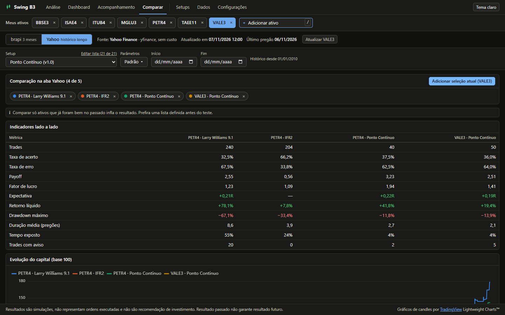
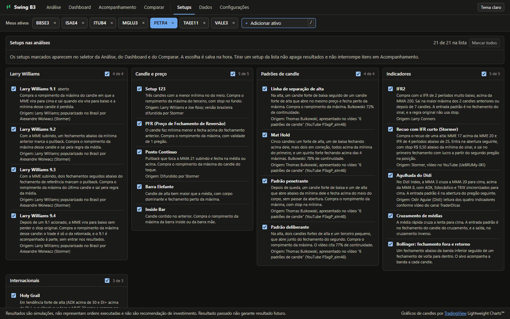
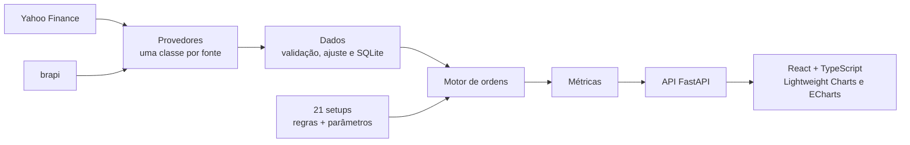

# Swing B3

**Backtest e acompanhamento simulado de swing trade em ações da B3.** O app baixa candles diários, aplica 21 setups conhecidos do mercado brasileiro e internacional e mostra, trade a trade, onde cada regra deu sinal, entrou e saiu, com métricas, curva de capital e comparação entre setups e ativos.

> Resultados são simulações. Não representam ordens executadas e não são recomendação de investimento. Resultado passado não garante resultado futuro.



## Destaques

- **21 setups em cinco famílias**, cada um com regras numéricas documentadas e parâmetros editáveis na tela:

  | Família | Setups |
  | --- | --- |
  | Larry Williams | 9.1, 9.2, 9.3, 9.4 |
  | Candle e preço | Setup 123, PFR, Ponto Contínuo, Barra Elefante, Inside Bar |
  | Padrões de candle (Bulkowski) | Linha de separação de alta, Mat Hold, Padrão penetrante, Padrão deliberante |
  | Indicadores | IFR2, Recuo com IFR curto (Stormer), Agulhada do Didi, Cruzamento de médias, Bollinger |
  | Internacionais | Holy Grail, 1-2-3 e Ross Hook, Tartarugas (Donchian) |

- **Cada trade se explica.** Ao clicar num trade, o gráfico centraliza nele e o painel conta o que aconteceu em cada candle: sinal, gatilho, entrada, stop e saída, com o preço e a regra aplicada.
- **Duas fontes de dados que nunca se misturam:** Yahoo Finance, com histórico desde 01/01/2010, e brapi, com janela de 3 meses. Cada uma tem sua aba, e a falha de uma não contamina a outra.
- **Métricas completas:** taxa de acerto, payoff, fator de lucro, expectativa em R, drawdown, tempo exposto e curva de capital contra o buy and hold e o Ibovespa.
- **Comparar** até 5 combinações de ativo, setup e parâmetros lado a lado.
- **Acompanhamento:** marca um setup num ativo e vê, a cada pregão, se há sinal ou ordem para o dia seguinte.
- **Avisos honestos:** alertas de qualidade nos candles, trades que dependem da ordem dos eventos dentro do candle e custos zerados aparecem na tela, em vez de ficarem escondidos no número final.

## Telas

| Dashboard | Comparar |
| --- | --- |
|  |  |

**Setups**: um painel por família, com a descrição e a origem de cada setup, para escolher quais aparecem nas análises.



## Como foi feito

O projeto começou por um documento de requisitos ([PRD](PRD%20aplicativo%20de%20swing%20trade%20para%20a%20B3.md)) e por um catálogo com a regra exata de cada setup ([`SETUPS_SWING_TRADE.md`](SETUPS_SWING_TRADE.md)). Quando a fonte original (livro, vídeo ou artigo) descreve um setup só no gráfico, o catálogo fixa limites numéricos e registra a adaptação. O código veio depois, e cada regra virou teste.



Algumas decisões que sustentam o resultado:

- **Um único motor de ordens.** Os setups não executam nada: declaram indicadores e pedem ordens (compra stop, compra na abertura, alvo, stop, saída no fechamento). O mesmo motor roda o backtest e o acompanhamento, então os dois nunca divergem.
- **Sem olhar o futuro.** O setup só recebe dados até o candle atual, e a ordem vale a partir do pregão seguinte. Um teste de contrato roda todos os setups registrados e confere isso, além de reprodutibilidade e formato das ordens.
- **Premissas à vista.** Sem dados intradiários, não se sabe se o stop ou o alvo veio primeiro dentro do mesmo candle. O motor assume o pior caso e marca o trade com aviso.
- **Preços ajustados** por proventos, guardando também o valor recebido da fonte.
- **Setups versionados.** Mudou a regra, sobe a versão, e os resultados antigos continuam ligados à versão que os gerou.
- **Histórico desde 2010**, aplicado de ponta a ponta: download, banco, simulação e o calendário da tela.

### Tecnologias

| Camada | Ferramentas |
| --- | --- |
| Backend | Python 3.13, FastAPI, pydantic, pandas, NumPy, SQLite, yfinance, httpx |
| Frontend | React 19, TypeScript, Vite, TradingView Lightweight Charts, Apache ECharts |
| Qualidade | pytest: 305 testes, com casos numéricos de cada setup e respostas gravadas dos provedores (sem rede) |
| Publicação | Docker: um container serve a API e a interface no mesmo endereço |

## Como rodar

### Com Docker

```bash
docker build -t swing-b3 .
docker run -p 7860:7860 swing-b3
```

Abra <http://localhost:7860>. O banco começa vazio, e cada ativo consultado é baixado do Yahoo desde 2010 em poucos segundos.

### Para desenvolver

Precisa de Python 3.11+ e Node 20+. No Windows, dê dois cliques em `iniciar.bat`: ele instala o que faltar, sobe backend e frontend e abre o navegador.

Ou manualmente, em dois terminais:

```powershell
# Terminal 1
cd backend
python -m venv .venv
.venv\Scripts\python -m pip install -r requirements.txt
.venv\Scripts\python -m uvicorn app.main:app --host 127.0.0.1 --port 8000

# Terminal 2
cd frontend
npm install
npm run dev
```

Abra <http://127.0.0.1:5173>. A documentação da API fica em <http://127.0.0.1:8000/docs>.

## Roteiro de teste

1. Na barra **Meus ativos**, no alto de todas as telas, clique em **Adicionar ativo** e escolha PETR4 na lista ou digite o código ou o nome (o atalho é `/`). As duas fontes baixam os dados, cada uma por conta própria.
2. Clique em um trade na tabela: o gráfico centraliza nele e o painel explica a regra de cada evento. As setas ↑ ↓ navegam entre os trades.
3. Troque entre as abas brapi e Yahoo: ativo, setup e parâmetros continuam, e os resultados são de cada fonte.
4. Mude os parâmetros (por exemplo, alvo de 2R) e os filtros de data.
5. Na tela **Setups**, escolha quais setups aparecem nas análises, por setup ou por família. O link "Editar lista", ao lado do seletor de setup, leva até lá.
6. Abra o Dashboard, depois use "Acompanhar" na Análise e "Atualizar agora" em Acompanhamento.
7. Adicione WEGE3 e alterne entre ele e PETR4 com um clique na barra. Sem token, só a aba brapi pede o token, e a aba Yahoo funciona normalmente.

**Token da brapi:** sem token, a brapi só responde para PETR4, MGLU3, VALE3 e ITUB4. Para outros ativos nessa aba, crie uma conta gratuita em [brapi.dev](https://brapi.dev/) e guarde o token em Configurações, que o testa na hora, ou use a variável de ambiente `BRAPI_TOKEN`. A conta gratuita continua limitada a 3 meses. A aba Yahoo não precisa de token. O caminho com um token real ainda não foi testado.

## O que esta versão entrega

| Área | Situação |
| --- | --- |
| Importação das duas fontes, cache em SQLite, atualização incremental | Pronto |
| Histórico fixo desde 01/01/2010: nada anterior é baixado, guardado ou simulado, e o calendário trava datas anteriores | Pronto |
| Acúmulo da brapi com rebase por provento e marcação de lacunas | Pronto, testado com respostas simuladas; um provento real ainda não passou por ele |
| Validação de candles e calendário da B3 | Pronto |
| Motor e Larry Williams 9.1, com todos os casos do PRD como teste | Pronto |
| Catálogo de 21 setups, com casos numéricos de cada um e opções em lista no formulário | Pronto |
| Registro de setups, com formulário gerado pelo esquema | Pronto |
| Análise, Dashboard, Comparar, Setups, Dados, Configurações | Pronto |
| Acompanhamento: lista, estados, ordens, histórico sem duplicar | Pronto, com atualização **manual** |
| Barra Meus ativos em todas as telas: adicionar, trocar com um clique, tirar da lista | Pronto |
| Tema escuro e claro, teclado, memória da última seleção, tablet e celular | Pronto |

### Ainda não incluído

- Atualização automática após o pregão e recuperação de pregões perdidos.
- Backup e restauração do banco. **Até lá, copie `backend/data/` de vez em quando:** os candles acumulados da brapi não podem ser baixados de novo.
- Comparação entre provedores.
- Versões de venda dos setups, pirâmide e saída parcial. As adaptações à especificação estão no PRD, em "Catálogo de setups".
- Trades de acompanhamento no dashboard.
- Edição de item de acompanhamento: para mudar parâmetros, remova e crie outro. O histórico fica guardado.

## Testes

```powershell
cd backend
.venv\Scripts\python -m pytest
```

Os testes não usam rede: os provedores rodam com respostas gravadas ou simuladas.

## Para incluir um setup

1. Crie a classe em `backend/app/setups/`, herdando de `SetupCompra` (`comum.py`), que já traz filtros globais e aquecimento.
2. Registre em `SETUPS`, no arquivo `registro.py`. Ele já aparece na API e nas telas.
3. Escreva os casos de referência. A suíte `tests/test_contrato_setups.py` já cobre contrato, reprodutibilidade e ausência de olhar o futuro de todo setup registrado.

Ao mudar a regra de um setup, aumente `versao`: os resultados antigos seguem ligados à versão que os gerou.

## Licenças e dados

Candles com [TradingView Lightweight Charts](https://github.com/tradingview/lightweight-charts) (Apache 2.0, com atribuição no rodapé) e painéis com Apache ECharts. O yfinance não tem vínculo com a Yahoo e se destina a uso pessoal e educacional.

O aplicativo não tem login: quem acessa o endereço pode baixar ativos, mudar configurações e criar acompanhamentos. Na versão publicada isso é proposital, para mostrar o app completo.
